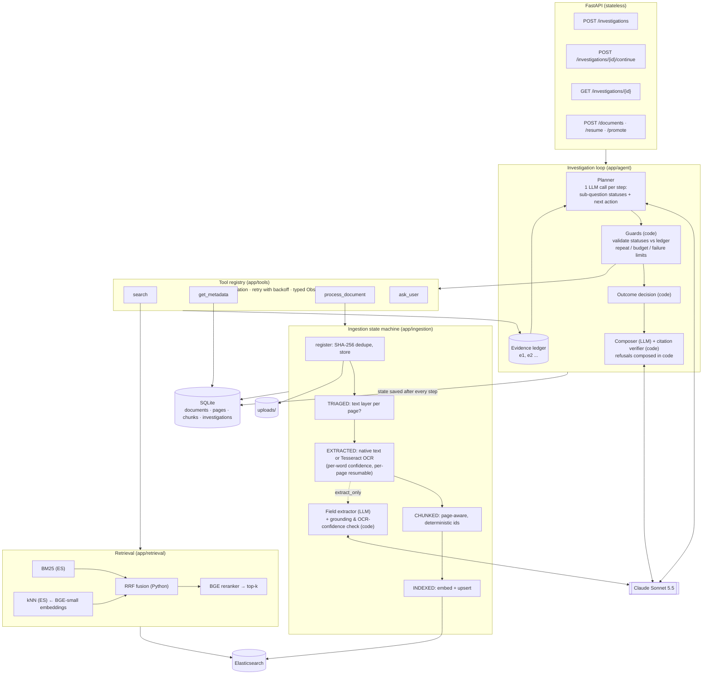

# System design

## 1. What it does

An investigation agent answers a question by deciding, step by step, which evidence it still needs and how to get it: hybrid search over indexed chunks, metadata lookups in SQLite, or OCR and extraction on a document the user uploads mid-investigation. It ends with either a cited answer or an explicit, typed reason why a reliable answer is not possible yet.

The core principle: **the LLM proposes, code decides.** The model plans and labels evidence; deterministic guards validate every claim against an evidence ledger and decide the final outcome.

## 2. Architecture

## 3. The investigation loop

1. **Plan.** The planner sees the question, sub-questions, the ledger (with rerank scores, OCR confidence and verification flags), attachments, history and system notes. It returns updated sub-questions (each `OPEN | SUPPORTED | MISSING | CONFLICTING | UNVERIFIED | INSUFFICIENT` with ledger ids) and one action. Output is schema-validated; one repair re-prompt on failure; then a safe fallback (finalize).
2. **Validate.** Code checks each claimed status: unknown ids are dropped; `SUPPORTED` needs verified evidence above the relevance floor or is downgraded to `UNVERIFIED`/`INSUFFICIENT`; `CONFLICTING` needs both sides.
3. **Guard.** Identical successful calls are blocked (normalized `(tool, args)` hash); a failing call may be retried once by the planner; step, repeat and consecutive-failure budgets force finalization.
4. **Act.** The tool registry validates arguments (bad args are an output problem, not a backend failure), retries transient errors with exponential backoff, and always returns a typed `Observation` (`OK`, `EMPTY`, `ERROR`, `BLOCKED`, `PAUSED`).
5. **Record.** Evidence goes into the ledger (deduplicated); the state is persisted.
6. **Pause or finish.** `ask_user` pauses (`NEEDS_INPUT`). At finalize, code decides the outcome; only answerable outcomes call the composer, whose citations are verified against the ledger.

### Distinguishing failure modes

| Situation | How it is detected | Outcome |
|---|---|---|
| Missing information | Planner marks `MISSING` (not in resources, user could supply) | `ask_user` pause, or `MISSING_INFO` |
| Tool failure | `Observation.status = ERROR` after retries; tracked per tool until a later success | `TOOL_FAILURE` (explicitly "not evidence of absence") |
| Insufficient evidence | Searched successfully but evidence weak / off-topic / below rerank floor | `INSUFFICIENT_EVIDENCE` |
| Contradictory evidence | `CONFLICTING` with both sides cited; agent consults metadata (effective date, supersedes) to resolve | resolved → normal outcome; unresolved → `CONFLICT` |
| Uncertain OCR | Field or chunk flagged `UNVERIFIED` by code | `ANSWERED_WITH_CAVEATS` only if the verdict is robust; else `INSUFFICIENT_EVIDENCE` |

### Misleading retrieval

The corpus contains a decoy (X300 manual, a 36-month programme). It scores well on "warranty" queries. Three things stop it from leaking into an answer: the planner is instructed that other-model evidence supports nothing and re-queries with a `product` filter; sub-questions must cite specific ids, so an answer cannot quietly rely on it; and the reranker floor stops weak chunks from supporting anything.

### Latency design

- **Fast path:** before the first LLM call the loop runs a hybrid search on the question itself (an obvious first step that needs no model). The planner therefore starts with evidence and, for simple or broad questions, finalizes in its first call and writes the answer in the same call. A simple question costs one LLM call; the composer is only used when the planner did not write an answer.
- **No repair round-trips:** the Ollama client sends the JSON schema as `format`, so decoding is constrained to it (structured output that always parses). The schema is transformed automatically (closed objects, optional fields nullable, free-form `args` encoded as a JSON string) and decoded back.
- **Lean prompts:** compact JSON, uncited older evidence abbreviated, a short system prompt.
- **Pacing instead of 429 storms:** the client reads `x-ratelimit-*` headers and waits for the token window before sending.
- **Measured, not guessed:** every step records model, tool and rate-limit wait times; the UI shows them.
- **Fail fast:** a rate-limit wait longer than `LLM_MAX_WAIT_S` (e.g. a daily quota) is reported at once with the time until it frees up; Elasticsearch has a circuit breaker, and a run whose first search fails with nothing else to work from stops before any LLM call.
- **Deterministic first steps:** attachments are indexed and searched, and amendments of retrieved documents (per `supersedes` metadata) are searched, before the first planner call.

### Answer review

Before an answer is accepted, code checks it: every date it states must appear in the evidence, the question or the user's replies, or follow from one of them by a period the sources name (purchase date + 12 months); and no document it relies on may have an unconsulted amendment. A failing answer is sent back to the planner with the specific problem (at most twice); a problem that survives becomes a caveat and the outcome cannot be ANSWERED.

### Live progress

The loop sets a per-investigation reporter (a context variable), so deep code such as the LLM client can report "Waiting for the model's rate limit (21s)" without knowing which investigation it serves. Reports go to an in-process activity board exposed as `activity` on `GET /investigations/{id}`. With several API workers the board would move to Redis (or the investigation would stream server-sent events from the worker that runs it).

### Chunking

Pages are split at section headings (numbered headings and schedules, carried across page breaks), then long sections are windowed. Each chunk keeps its page and a `section` label; BM25 searches text, section (boosted) and document title, and embeddings and the reranker see "document - section" plus the text. This keeps a broad question such as "what is covered?" on the right section instead of on whichever fixed-size window happened to contain the words.

## 4. On-demand document intelligence

- **Upload is cheap.** Registration stores the file, dedupes by SHA-256 and triages pages (text layer present?). No OCR, no embedding.
- **Processing is chosen by the agent.** `process_document` with `extract_only` OCRs only pages without a text layer and asks the LLM for named fields; `index` additionally chunks, embeds and indexes (session or global scope). A receipt is one-off evidence, so `extract_only`; a long report the user will search repeatedly is `index`.
- **OCR uncertainty is preserved.** Tesseract gives per-word confidence. Low-confidence words are shown to the LLM as `[[?word]]`. Extracted values are re-checked in code: the source text must appear on the page (catches "corrected" values), and the confidences of exactly those words decide `VERIFIED` vs `UNVERIFIED`. Chunks with any low-confidence word are `UNVERIFIED` too.
- **Visibility.** Session documents are searchable only by their investigation (ES `scope` field plus an attachment filter); `/documents/{id}/promote` makes them global.

## 5. Reliability

| Concern | Mechanism |
|---|---|
| Malformed model output | Pydantic validation → one repair prompt with the error → safe fallback; composer falls back to a deterministic, cited answer |
| Hallucinated citations | Citation verifier keeps only ledger ids; every answered sub-question must be cited; no valid citations → refusal |
| Tool failures | Typed observations, retries with backoff for transient errors, degraded modes (no reranker → fused order; no embeddings → BM25) |
| Repeated calls | Normalized call hash; blocked and reported to the planner |
| Runaway loops | Step budget, repeat budget, consecutive-failure budget |
| Duplicate uploads | SHA-256 unique index; concurrent identical uploads resolved by the DB constraint |
| Interrupted ingestion | `status` = last completed stage; idempotent stages; page-level resume inside OCR; atomic `processing` lock; stale locks cleared and pending documents resumed on startup |
| Interrupted investigations | State saved after every step; `RUNNING` at startup → `INTERRUPTED`; `/continue` resumes; atomic claim prevents two runs at once |

## 6. Testability

Every external dependency sits behind a small protocol: `LLMClient`, `SearchIndex`, `Embedder`, `Reranker`, `OCREngine`. `app/container.py` wires real or fake implementations. Tests use `ScriptedLLM` (outputs can be functions of the exact prompt the real model would see), `InMemoryIndex`, `HashEmbedder`, `OverlapReranker` and `FakeOCR`. The suite covers the end-to-end demo through HTTP, every failure case above, ingestion resume, OCR grounding, retrieval degradation and outcome logic. Real-Tesseract and real-Elasticsearch tests run when those are available.

## 7. Scaling

**Concurrent users.**
- The API is stateless; all state is in the database. Run several uvicorn workers or replicas behind a load balancer.
- Investigations are claimed atomically, so two requests can never run the same one.
- Move long work off the request path: `POST /investigations` enqueues a job (Celery/RQ/Arq on Redis) and returns `202` with an id; clients poll `GET /investigations/{id}` or receive a webhook/SSE stream. The loop code does not change, because it already resumes from persisted state.
- OCR and embedding run in separate worker pools (CPU for OCR, GPU for embeddings/reranking), sized independently.
- Replace SQLite with Postgres (row-level locks for `try_lock` / `claim_investigation` via `SELECT ... FOR UPDATE SKIP LOCKED`). Only `app/db/repo.py` changes.
- Per-user rate limits and per-investigation token/step budgets bound LLM cost.

**Larger collections.**
- Elasticsearch: shard by tenant or collection, add replicas for read throughput, use int8-quantized `dense_vector` HNSW to cut memory, and keep metadata filters (`doc_type`, `product`, `scope`) as pre-filters for kNN.
- Bulk ingestion through the same state machine, run by many workers; deterministic chunk ids make retries safe.
- Uploaded files move from local disk to object storage (S3/Azure Blob); the pipeline only needs a path or URL.
- Cache query embeddings and reranker results for hot queries; cache LLM extraction per `(doc_id, fields)`.
- For very large candidate sets, rerank in batches on GPU, or use a smaller reranker for a first pass.

## 8. Known limitations

- `robust_to_unverified` is a model judgement; the guard enforces that it must be stated, not that the reasoning is correct. A stricter version would ask the model for candidate readings of each uncertain value and recompute the verdict for each.
- Word-level OCR confidence is coarse: a smudge on one digit lowers the whole token.
- The investigation runs synchronously inside the request for this prototype (see §7 for the queued design).
