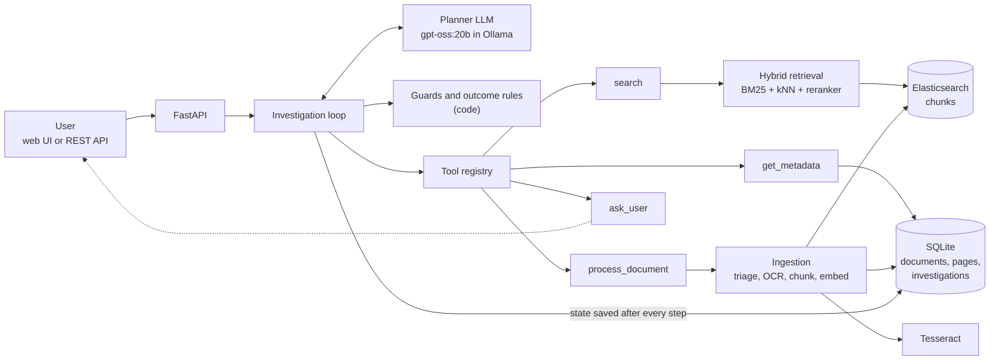

# System design

## 1. Purpose and core idea

The system answers questions about a document collection by **investigating**: it decides step by step what
evidence it still needs, gets it (search, metadata, OCR of an uploaded document, or a question to the user), and
finishes with either a **cited answer** or an **explicit reason** why a reliable answer is not possible.

One principle shapes the design: **the LLM proposes, code decides.** The model plans the next step and labels
evidence; deterministic code checks every claim against the evidence actually collected, checks OCR confidence word
by word, and decides the final outcome. A model mistake therefore leads to a refusal or a caveat, not a wrong
answer presented as fact.

## 2. Architecture

| Component | Responsibility | Code |
|---|---|---|
| FastAPI | Start / continue / inspect investigations, upload documents, serve the UI | `app/api/`, `app/main.py` |
| Investigation loop | Runs plan → validate → act → record until finished | `app/agent/loop.py` |
| Planner | One LLM call per step: updated sub-questions + one next action, as schema-constrained JSON | `app/agent/planner.py` |
| Guards | Validate the planner's claims, block repeats, enforce budgets, review the answer, decide the outcome | `app/agent/guards.py` |
| Evidence ledger | Every piece of evidence with an id (`e1`, `e2` ...), source, page and verification flag | `app/agent/ledger.py` |
| Tools | `search`, `get_metadata`, `process_document`, `ask_user`; argument validation, retries, typed results | `app/tools/` |
| Retrieval | Elasticsearch BM25 + kNN (BGE-small embeddings), fused with a BGE reranker | `app/retrieval/` |
| Ingestion | Per-page text-layer check, Tesseract OCR with per-word confidence, chunking, embedding, indexing | `app/ingestion/` |
| LLM client | Ollama native API: JSON schema as output grammar, low reasoning effort, 16k context | `app/llm/ollama.py` |

## 3. How an investigation runs

1. **Automatic first steps (no LLM).** Search the question; read any attached document; if a retrieved document has
   an amendment, search that too. The planner starts with evidence already in the ledger.
2. **Plan.** The LLM splits the question into sub-questions, each with a status (`SUPPORTED`, `MISSING`,
   `CONFLICTING`, `UNVERIFIED`, `INSUFFICIENT`, `OPEN`) and the evidence ids behind it, and picks one action.
3. **Validate (code).** Unknown evidence ids are dropped; `SUPPORTED` needs relevant, verified evidence; a claim on a
   scanned page is accepted only if the words it rests on were read with high confidence.
4. **Act.** The chosen tool runs; its result is added to the ledger; the state is saved.
5. **Repeat** until the planner finalizes, asks the user (the run pauses with `NEEDS_INPUT`), or a budget is reached
   (12 steps, repeated or failing calls).
6. **Finish (code).** The answer is reviewed (section 6), the outcome is decided from the validated statuses, and
   citations are checked against the ledger. Refusals are written by code, not by the model.

A simple question typically takes one LLM call; the main warranty question takes a few, plus one pause for the
receipt.

## 4. Outcomes

| Outcome | Meaning | Decided by |
|---|---|---|
| `ANSWERED` | Every required part is supported by verified, cited evidence | All required sub-questions `SUPPORTED` |
| `ANSWERED_WITH_CAVEATS` | Answered; what is missing or relies on the user's own statement is stated | Some optional/unfound parts, or user-stated facts |
| `MISSING_INFO` | A needed fact is in no document but the user could supply it (asked once) | A required sub-question `MISSING` |
| `INSUFFICIENT_EVIDENCE` | Evidence is weak, uncertain or off-topic, or the question is outside the documents | Unverified decisive OCR, unknown model, nothing relevant retrieved |
| `CONFLICT` | Sources disagree and nothing (e.g. versioning) resolves it | A `CONFLICTING` sub-question citing both sides |
| `TOOL_FAILURE` | A component failed - not evidence that the answer is unavailable | A tool still failing after retries |

## 5. Retrieval

- **Chunking:** pages are split at section headings (carried across page breaks), long sections into ~220-word
  windows; each chunk keeps document, page and section, with a deterministic id `doc:page:index`.
- **Hybrid search:** BM25 (text, section, title) and kNN on `bge-small-en-v1.5` embeddings, 20 candidates each.
- **Ranking:** `bge-reranker-base` scores the candidates; BM25, kNN and reranker rankings are combined by reciprocal
  rank fusion. A passage counts as relevant if the reranker scores it ≥ 0.03 or it is in the fused top 3.
- **Versions:** document metadata in SQLite records what supersedes what; when a policy is retrieved, its amendment
  is fetched as well, so "24 months vs 12 months" is resolved rather than guessed.
- **Out of scope:** if the best reranker score of everything retrieved is below 0.008, nothing relates to the
  question; the agent does not ask the user and the outcome is `INSUFFICIENT_EVIDENCE`.
- **Measured:** 42 held-out questions (never used for tuning) measure recall and MRR per question type
  (`scripts/eval_retrieval.py`).

## 6. Trust: OCR and answer checks

**Documents and OCR**

- An upload is registered cheaply (SHA-256 hash, file stored, pages triaged); nothing heavy runs until it is needed.
- Each page uses its text layer if it has one; only pages without one are OCR'd (Tesseract 5, confidence per word).
- Ingestion is a resumable state machine: `RECEIVED → TRIAGED → EXTRACTED → CHUNKED → INDEXED`, with per-page OCR
  progress and a processing lock.
- **Word-level verification:** a value is `VERIFIED` only if every OCR word that spells it has confidence ≥ 80. A
  smudged signature elsewhere on the page does not affect a clearly printed "COMMERCIAL"; a smudged digit in the
  date does make the date `UNVERIFIED`, and an `UNVERIFIED` value that decides the verdict blocks the answer.
- An upload is visible only to the investigation it is attached to.

**Answer review (before an answer is accepted)**

| Risk | Control in code |
|---|---|
| Invented or misused dates | Every date must appear in the evidence or follow from an evidence date by a period the documents state; a document's own effective date may not be used to compute a deadline |
| Outdated rules | An answer may not rely on a document whose amendment was not consulted |
| Unknown products | Model numbers / serials in the question must appear in some document, otherwise no answer |
| Made-up citations | Only ledger ids survive; each answered sub-question must be cited |

A failing answer is sent back to the planner with the specific problem (at most twice); if it persists, the answer
is withheld or downgraded.

## 7. Reliability

| Failure | Handling |
|---|---|
| Malformed model output | Schema-constrained decoding; one repair round with the validation error; prompt-only retry for empty replies; safe finalize |
| Tool error | Typed results (`OK`, `EMPTY`, `ERROR`, `BLOCKED`, `PAUSED`); retries with backoff for transient errors; bad arguments are not retried |
| Degraded services | No embeddings → BM25 only; no reranker → fused order; Elasticsearch down → circuit breaker and an immediate `TOOL_FAILURE` |
| Repeated tool calls | Calls hashed on tool + normalised arguments; identical calls blocked |
| Runaway loops | Step budget (12), repeat and consecutive-failure budgets |
| Duplicate uploads | Same bytes (any file name) → same document, not reprocessed |
| Crash mid-processing | On startup: stale locks cleared, documents resume from their last completed stage (OCR'd pages are not redone), running investigations become `INTERRUPTED` and can be resumed |

## 8. Data

| Store | Contents |
|---|---|
| SQLite (WAL) | `documents` (metadata, hash, scope, processing state), `pages` (text, per-word OCR confidence), `chunks`, `investigations` (full state after every step) |
| Elasticsearch | Index `chunks`: text, section, document name, page, scope, product, doc type, verification flag, 384-d vector |
| Disk | Uploaded files (`data/uploads/`) |

## 9. Testability

Each external service sits behind a small interface (LLM, search index, embedder, reranker, OCR), wired in
`app/container.py`. The 156 tests swap in fakes - including a scripted LLM whose replies can depend on the exact
prompt the real model would see - so the whole workflow and every failure case run without Elasticsearch, models or
network. Real Tesseract and Elasticsearch tests run when available (and in CI).

## 10. Scaling

**Concurrent users**
- The API holds no state; run several workers behind a load balancer. Investigations are claimed atomically, so one
  can never run twice at the same time.
- Move investigations to a job queue (e.g. Redis + RQ/Celery): the API returns an id, clients poll or stream
  progress. The loop already resumes from saved state, so it does not change.
- Replace SQLite with PostgreSQL (row locks for claims); only `app/db/repo.py` changes.
- Serve the LLM from a GPU inference server (e.g. vLLM or several Ollama nodes); OCR and embedding run in their own
  worker pools.

**Larger collections**
- Shard Elasticsearch by tenant or collection, add replicas, and use quantized vectors to cut memory; keep metadata
  filters (product, document type, scope) as pre-filters.
- Ingest in bulk through the same state machine with many workers; deterministic chunk ids make retries safe.
- Store files in object storage (S3 / Azure Blob) instead of local disk.
- Replace the corpus list shown to the planner with a metadata search tool once there are hundreds of documents.

## 11. Trade-offs and limitations

- **Local 20B model:** private and free to run, but slower and weaker at planning than large hosted models; the code
  guards compensate by refusing rather than guessing.
- **Thresholds** (OCR 80, relevance 0.03, off-topic 0.008) are calibrated on this corpus and should be re-checked on
  a new one with `scripts/eval_retrieval.py`.
- **Unknown-entity check** recognises code-like identifiers (X900, AQ-...), not unknown plain names.
- **Prototype scope:** single node, no authentication, Elasticsearch security disabled.
